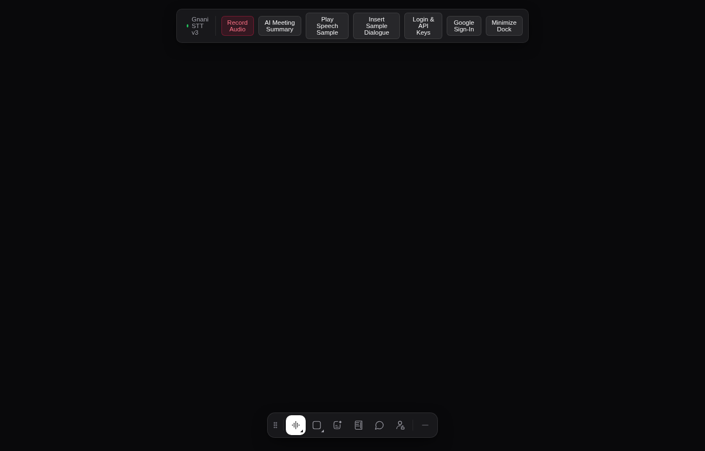
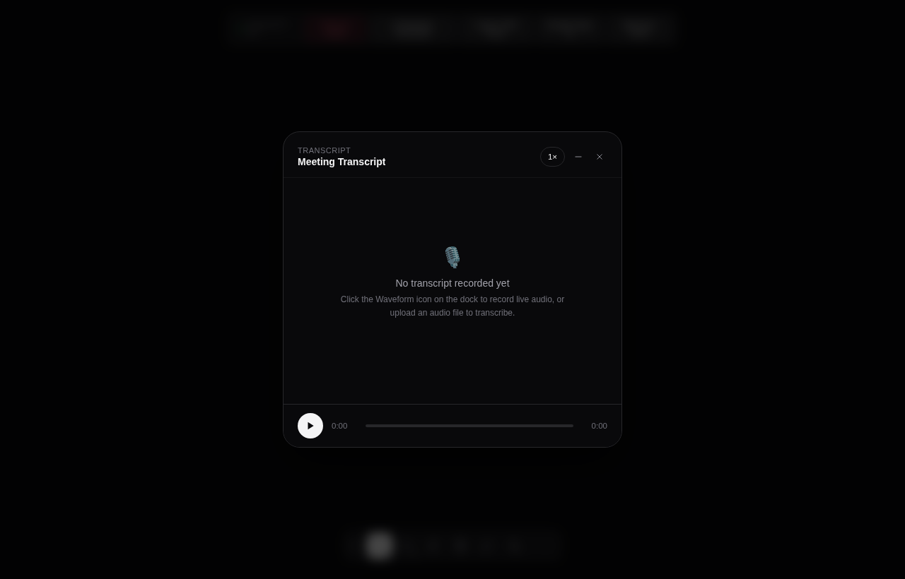
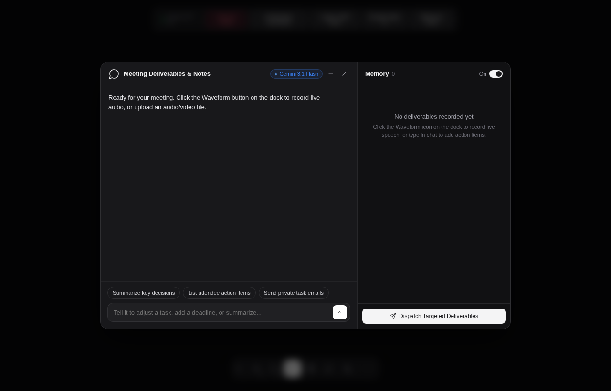
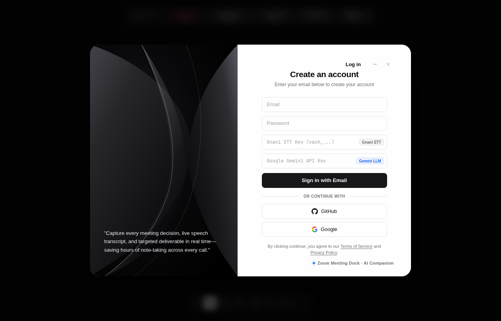

# Gnani Zoom AI Meeting Dock 🎙️⚡

A floating, multi-edge dockable AI meeting companion for Chrome, Zoom, Google Meet, and YouTube. Powered by **Gnani.ai Prisma v3.0 Speech-to-Text** for rapid speech transcription, **Google Gemini** for executive meeting summaries and targeted personal deliverables, and **KokonutUI** synced transcript playback with wave-animated AI thinking indicators.



---

## ✨ Features

- **Floating Multi-Edge Tool Dock**:
  - Positions along any viewport boundary (`bottom`, `left`, `top`, `right`) with auto-orientation and smooth drag gestures.
  - One-click minimize pill button (`—`) to collapse the dock to an unobtrusive floating badge.
  - Keyboard shortcuts for all core actions (`R` to record, `S` for summary, `T` for transcript, `K` for keys/auth, `Esc` to close modals).

- **Simple Live Meeting STT**:
  - Click once to start listening and click again to end the meeting.
  - Uses **Gnani Prisma v3.0** with Hindi + English code-mix recognition.
  - Captures what you **hear** (this tab's audio: YouTube, Zoom Web, Meet participants) mixed with your **microphone**. Choose the source from the arrow next to the record button: *This tab + microphone* (default), *Pick a window or screen* (system audio, e.g. the Zoom desktop app on Windows) or *Microphone only*.
  - Chrome shows its sharing dialog when recording starts. Keep **Also share tab audio** ticked. The video track is disabled and never read.
  - Transcript updates continuously in 4-second chunks, transcribed in order (none are dropped), and each word receives a calculated timestamp for transcript playback/highlighting.
  - STT errors (bad key, network, blocked permission) are shown in the dock instead of failing silently.

- **KokonutUI Synced Transcript Player**:
  - Live karaoke-style word highlighting synchronized to audio playback.
  - Scrubbable time slider with interactive seeking (`[time]`) and adjustable playback speeds (`1×`, `1.5×`, `2×`).
  - Auto-scrolling transcript with floating "Back to now" pill indicator.

- **AI Meeting Report + Transcript Q&A**:
  - Powered by **Google Gemini / Flash-Lite** (`gemini-3.1-flash-lite`, `gemini-flash-latest`).
  - When the meeting ends, the full current-session transcript is sent to Gemini once to generate:
    1. **Executive Overview**
    2. **Key Discussion Points**
    3. **Key Decisions**
    4. **Action Items & Deliverables**
    5. **Risks / Blockers**
    6. **Next Steps**
  - Ask follow-up questions from the current transcript in the same summary window.
  - KokonutUI staggered wave animation with dynamic word cycling (`Thinking...`, `Processing...`, `Analyzing...`, `Computing...`, `Almost...`) and live elapsed seconds timer.

- **Modular API Architecture**:
  - Dedicated client services under `apis/` (`gemini-llm.js`, `gnani-stt.js`, `index.js`).
  - Multi-model automatic fallback handling (503 / 404 recovery).

- **Privacy & Local Credential Sandbox**:
  - 100% ephemeral audio processing: audio buffers are converted to WAV PCM in volatile RAM and immediately garbage collected after transcription.
  - Zero server telemetry or continuous audio recording.
  - API keys are stored in `chrome.storage.local` (shared across every site, not readable by page scripts) and are only sent to Gnani and Google.
  - Built-in Terms of Service (`pages/terms.html`) and Privacy Policy (`pages/privacy.html`).

---

## 🆕 What changed in 1.1

- **Fixed: STT not hearing tab / YouTube audio.** Capture had been reduced to the microphone, with echo cancellation on, which removes speaker output. Tab audio is captured again and mixed with the mic.
- **Fixed: silent failures.** Missing/invalid keys, blocked permissions and API errors are now reported, and a failed start no longer leaves the dock stuck on "recording".
- **Fixed: keys per website.** Keys were saved in each site's own `localStorage`, so a key entered on one site was missing on another. They now live in `chrome.storage.local`.
- **Fixed: page CSP/CORS.** Gnani and Gemini requests are made by the background service worker, so strict pages cannot block them.
- **Fixed: dropped audio.** Chunks that arrived while an upload was running were discarded; they are now queued. The last partial chunk is sent at the correct sample rate when you stop.
- **New setup panel** for the two keys, with show/hide, paste, per-key *Test*, status badges and an optional report email. The placeholder email/password and fake Google/GitHub sign-in were removed.
- **After reloading the extension at `chrome://extensions`, refresh any open meeting tab** so the page reconnects to it.

---

## 📸 Screenshots

| View | Screenshot |
|---|---|
| **Synced Transcript Player** |  |
| **Deliverables & Notes Chat** |  |
| **Login & Dual API Keys** |  |

---

## 🚀 Quick Start Guide

### Option 1: Standalone Studio Preview (No Extension Required)

You can run and test the complete dock directly in any modern browser without installing an extension:

1. Open `preview.html` in Chrome, Brave, or Edge:
   ```bash
   google-chrome preview.html
   # or
   chromium preview.html
   ```
2. Click **Record Audio** on the top toolbar or click the Waveform button on the floating dock.
3. Configure your API keys in the **Login & API Keys** panel.

### Option 2: Load as Unpacked Chrome Extension (Manifest V3)

1. Open Google Chrome and navigate to:
   ```text
   chrome://extensions/
   ```
2. Enable **Developer mode** toggle in the top-right corner.
3. Click the **Load unpacked** button.
4. Select this directory (`zoom-meeting-dock`).
5. Open any Zoom Web, Google Meet, or web meeting tab. The dock automatically attaches to the bottom of the viewport!

---

## 🔑 API Configuration

The extension requires two API services:

1. **Gnani.ai Prisma v3.0 Speech-to-Text**:
   - Model: `prisma-v3.0`
   - Languages: `hi-IN` + `en-IN`
   - Mode: `codemix`
   - Endpoint: `https://api.vachana.ai/stt/v3`
   - Enter your `vach_...` key in the **Login & API Keys** modal.
2. **Google Gemini LLM**:
   - Model: configured in `apis/gemini-llm.js` with fallback support
   - Obtain a key from [Google AI Studio](https://aistudio.google.com/).
   - Enter your key in the **Login & API Keys** modal.

API keys are stored locally in the browser (`chrome.storage.local`). Meeting transcripts are kept only in memory for the active meeting and are not persisted as previous-meeting history. After Gemini generates the report, the extension opens a pre-filled email to the signed-in email address. A mail provider OAuth integration would be required for silent background sending.

---

## 📁 Repository Structure

```text
├── apis/
│   ├── gemini-llm.js        # Google Gemini LLM API client (Gemini 3.1 Flash)
│   ├── gnani-stt.js         # Gnani.ai / Vachana.ai STT v3 API client
│   └── index.js             # Unified API module exports
├── assets/
│   └── screenshots/         # Polished product screenshots
├── content/
│   ├── dock.css             # Shadow DOM styling & KokonutUI animations
│   └── dock.js              # Complete floating dock runtime & audio pipeline
├── pages/
│   ├── privacy.html         # Privacy Policy documentation
│   └── terms.html           # Terms of Service documentation
├── background.js            # Manifest V3 service worker
├── manifest.json            # Chrome Extension Manifest V3 configuration
├── preview.html             # Standalone browser testbench & studio canvas
├── .env.example             # Example environment variables template
├── .gitignore               # Clean Git exclusion rules
├── LICENSE                  # MIT License
└── README.md                # Project documentation
```

---

## 🔒 Security & Privacy

- **Audio Ephemerality**: All audio processing happens in volatile browser memory.
- **No video**: the camera is never requested (`video: false` for the microphone). Tab audio uses `getDisplayMedia`, which requires a video request; that video track is disabled immediately and never read.
- **Safe Sharing**: The codebase contains zero hardcoded API keys or private tokens.

---

## 📄 License

This project is open-source and distributed under the [MIT License](LICENSE).
